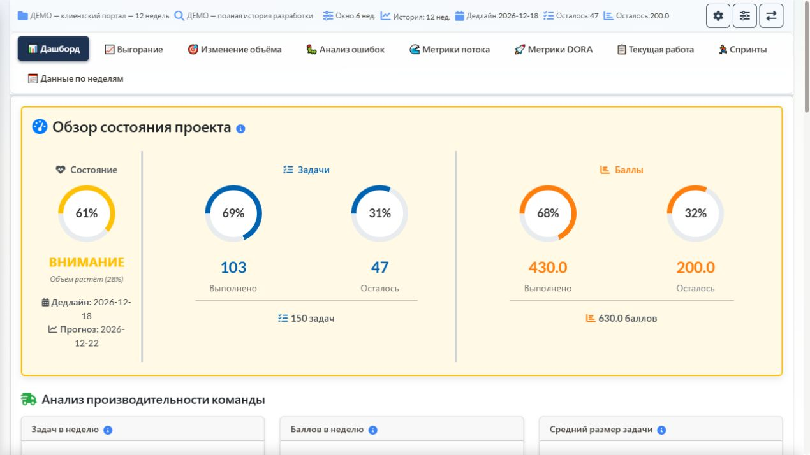

# Burndown RU

Русская версия [niksavis/burndown-chart](https://github.com/niksavis/burndown-chart), основанная на v2.15.3. Автор оригинала — Niksa Visic. Лицензия MIT сохранена в `LICENSE`.



Локальный дашборд управления проектами: диаграмма выгорания, прогноз завершения, изменение объёма, анализ ошибок, метрики Flow и DORA, бюджет и HTML-отчёты. Данные хранятся на компьютере.

## Запуск в Windows

Нужен Python 3.14. При первой установке запустите `setup-ru.cmd`: он создаст виртуальное окружение, установит зависимости и добавит отдельный демонстрационный проект. Затем запускайте `start-ru.cmd`.

Откройте [http://127.0.0.1:8051](http://127.0.0.1:8051). Оригинальная установленная версия может работать параллельно на порту 8050: базы и папки у них разные.

Ручная установка:

```powershell
python -m venv .venv
.\.venv\Scripts\python.exe -m pip install -r requirements.txt
.\.venv\Scripts\python.exe setup_demo.py
.\.venv\Scripts\python.exe app.py --port 8051
```

## Демонстрационный проект

`examples/demo-freelance.json` содержит полностью вымышленные данные разработки клиентского портала: 150 задач, 103 выполнены, 47 осталось; 12 недель истории, рост требований, ошибки и снижение темпа перед дедлайном 18 декабря 2026 года. Это фиксированный учебный пример, его даты со временем устаревают.

Порядок знакомства: **Дашборд → Выгорание → Изменение объёма → Анализ ошибок → Данные по неделям**. Для демо не нужны аккаунт Jira и API-токен. Скрипт не заменяет существующие профили. История переходов, бюджет, DORA и спринты в этом примере отдельно не моделируются.

## Область перевода

Переведены основные экраны, навигация, настройки, карточки, предупреждения, подписи графиков и заголовки HTML-отчётов. Английские названия полей Jira, статусы задач, ключи API и форматы экспорта сохранены для совместимости. В развёрнутой справке, отдельных технических сообщениях и пояснениях отчётов ещё встречается английский текст.

Математика прогнозирования остаётся исходной: PERT/EWMA. Расширенная диаграмма по Дорофееву здесь пока не реализована; её интеграция — отдельная следующая задача. Данные демо позволяют оценить интерфейс исходного продукта.

Обновления этой копии проверяются в `Stepansky0012/burndown-chart-ru`, чтобы обновление оригинала не затёрло перевод. Готовая Windows-сборка RU пока не выпускается: запуск из исходников описан выше.

Оригинальная документация: [readme.md](readme.md).
