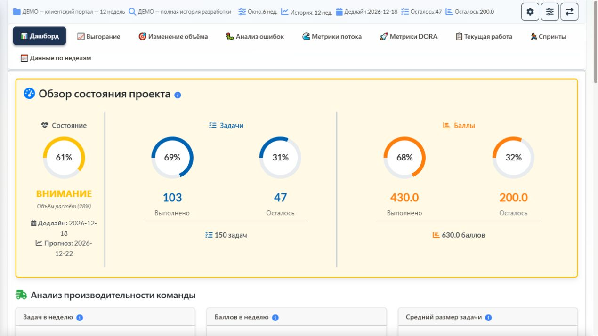

# Управление проектами: сроки, объём и прозрачная отчётность

**Рабочее место руководителя проекта и фрилансера: от истории задач до прогноза завершения и разговора с заказчиком на основе данных.**

Решение объединяет данные Jira, анализ выполнения работ и управленческие отчёты в локальном веб-интерфейсе. Показывает, сколько сделано, что осталось, как меняются требования и какие риски мешают уложиться в срок.



## Какие задачи решает

- **Контроль сроков.** Прогноз завершения по фактическому темпу команды, несколько сценариев и интервалы неопределённости.
- **Контроль изменений.** Видимость новых требований и роста бэклога помогает обсуждать изменение состава поставки, сроков и стоимости работ.
- **Подготовка статуса.** Единая сводка прогресса, рисков и показателей сокращает ручную сборку отчётности.
- **Несколько заказов.** Отдельные профили и запросы позволяют переключаться между проектами и командами.
- **Качество и поток работ.** Анализ ошибок и незавершённых задач помогает находить задержки в процессе.

## Пользовательский сценарий

1. Подключите Jira или импортируйте подготовленные данные проекта.
2. Выберите проект, период истории и целевой срок завершения.
3. Посмотрите выполненный и оставшийся объём, темп работ и прогноз.
4. Сопоставьте рост требований, динамику ошибок и риски по срокам.
5. Согласуйте с заказчиком приоритеты, состав ближайшей поставки или дату завершения.
6. Сформируйте HTML-отчёт для встречи или регулярного статуса.

Например, к согласованному заказу постепенно добавляются новые функции. Дашборд помогает показать выполненную работу и увеличение объёма, а затем обосновать пересмотр плана на общих с заказчиком данных.

## Преимущества интеграций

| Возможность | Что получает пользователь |
|---|---|
| Jira и сохранённые запросы | Рабочий трекер становится источником фактов; меньше повторного ввода данных |
| Обновление изменившихся задач и локальный кэш | Повторное получение данных без полной загрузки всей истории при каждом обновлении |
| Настройка соответствия полей | Адаптация к структуре конкретного проекта и его оценкам трудоёмкости |
| Импорт и экспорт профилей и данных | Перенос настроек и анализ подготовленных наборов без обязательного подключения Jira |
| Автономные HTML-отчёты | Заказчик открывает отчёт без установки приложения |
| Подготовка сводки для ИИ-анализа | Готовый контекст для дополнительного разбора в выбранном ИИ-инструменте; передачу выполняет пользователь |
| Раздельные профили | Свои настройки и представления для нескольких команд или заказов |

## Возможности приложения

- Дашборд состояния проекта, выполненных задач и оставшейся работы.
- Диаграммы выгорания и недельного темпа выполнения.
- Прогнозы завершения и предупреждения об отклонении от дедлайна.
- Контроль изменения объёма и появления новых задач.
- Анализ ошибок, текущей работы и спринтов.
- Метрики потока работ и эффективности поставки DORA.
- Бюджетные показатели при заполненных финансовых настройках.
- Выгрузка отчётов и данных для дальнейшего анализа.

Доступность отдельных показателей зависит от полноты истории и настройки полей. Прогнозы используют PERT и экспоненциальное взвешивание. Расширенная диаграмма по Дорофееву пока не реализована.

## Быстрый запуск в Windows

Нужен Python 3.14.

1. Скачайте репозиторий или клонируйте его:

   ```powershell
   git clone https://github.com/Stepansky0012/burndown-chart-ru.git
   cd burndown-chart-ru
   ```

2. Запустите `setup-ru.cmd`: установятся зависимости и демонстрационный профиль.
3. Запустите `start-ru.cmd`.
4. Откройте [дашборд на своём компьютере](http://127.0.0.1:8051).

Приложение работает локально, база хранится в папке `profiles/`. Подключение Jira требует сетевого доступа к выбранному серверу. Готовая сборка в виде исполняемого файла пока не публикуется.

## Попробуйте без подключения Jira

В комплекте есть вымышленный проект разработки клиентского портала: **150 задач, 12 недель истории, 103 выполненные и 47 оставшихся задач**. Сценарий показывает рост требований, ошибки и снижение темпа перед целевой датой.

Откройте вкладки **Дашборд → Выгорание → Изменение объёма → Анализ ошибок → Данные по неделям**. Для демонстрации не нужны токен и аккаунт Jira. Даты примера фиксированы; бюджет, история переходов, DORA и спринты отдельно в нём не моделируются.

## Документация

[Инструкция по установке и работе](README.ru.md) содержит команды ручного запуска и проверки проекта.

Основной интерфейс, графики и заголовки отчётов переведены на русский язык. В отдельных подробных подсказках и технических сообщениях ещё встречается английский текст. Автоматические сборки на GitHub пока не подключены.

Условия использования и обязательные уведомления приведены в [лицензии MIT](LICENSE).
